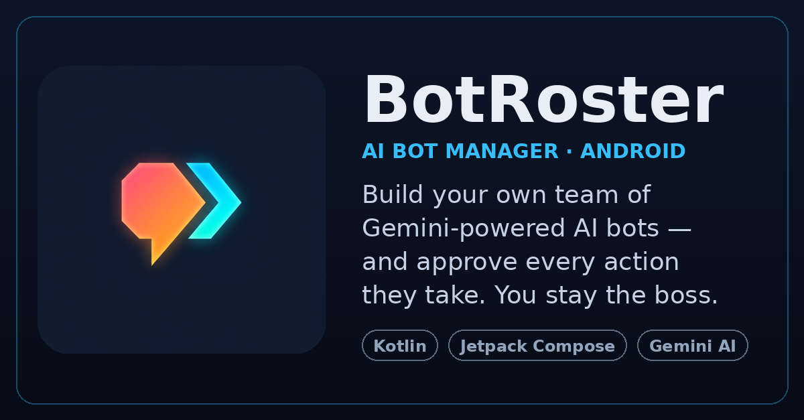
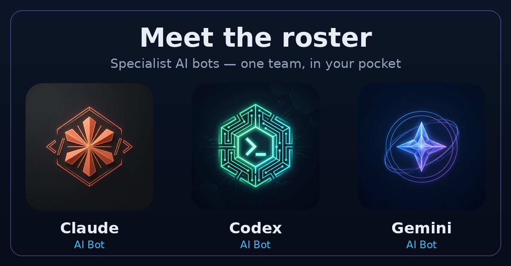

# BotRoster — Your Personal Team of AI Assistants

**An Android app for managing a roster of AI bots, powered by Google Gemini.**

BotRoster lets you create and organise a personal team of AI assistants, chat with each one, connect your apps, and stay in control: bots propose actions, and nothing runs without your approval.

## Download
**Latest release: [v2.1](https://github.com/kamalmosadegh/botroster/releases/tag/v2.1)** — download `BotRoster-v2.1.apk` from the release and install it. It installs as an update over v2.0 and keeps your bots and data. To enable chat replies, paste a free Gemini API key from Google AI Studio under **Computer → Gemini API** in the app.

## Features
- **Multiple bots, one roster** — create, organise and switch between specialised AI assistants
- **Chat with each bot** — persistent per-bot conversations (Room database)
- **Connected apps** — link apps to your workspace and let bots work with them
- **Approval protocol** — bots propose actions; you approve or reject before anything executes
- **Workspace events** — a visible activity trail of what your bots did and when

## Tech
- Kotlin · Jetpack Compose · MVVM
- Google Gemini API (bot engine)
- Room (local persistence)
- Android SDK 36

## Status
In active development — installable builds are published under Releases as they land.

## Author
**Kamal Mosadegh** — freelance developer (trading bots, games, data models, Android apps)
Portfolio: https://kamalmosadegh.github.io · Contact: kamalmosadegh6977@gmail.com
